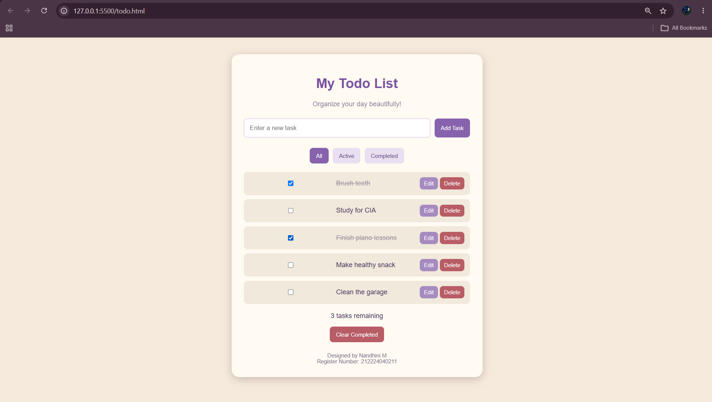

# Ex03 To-Do List using JavaScript
## Date: 17-11-2026

## AIM
To create a To-do Application with all features using JavaScript.

## ALGORITHM
### STEP 1
Build the HTML structure (index.html).

### STEP 2
Style the App (style.css).

### STEP 3
Plan the features the To-Do App should have.

### STEP 4
Create a To-do application using Javascript.

### STEP 5
Add functionalities.

### STEP 6
Test the App.

### STEP 7
Open the HTML file in a browser to check layout and functionality.

### STEP 8
Fix styling issues and refine content placement.

### STEP 9
Deploy the website.

### STEP 10
Upload to GitHub Pages for free hosting.

## PROGRAM

```
<html>
<head>
<title>My Todo List</title>
<style>
* {
    box-sizing: border-box;
}
body {
    font-family: Arial, sans-serif;
    background: #f5eadb;
    margin: 0;
    padding: 40px 15px;
    color: #49365f;
}
.container {
    max-width: 600px;
    margin: auto;
    background: #fffaf2;
    padding: 30px;
    border-radius: 18px;
    box-shadow: 0 5px 20px #cbb9b0;
}
h1 {
    text-align: center;
    color: #7952a3;
}
.subtitle {
    text-align: center;
    color: #927f9e;
}
.input-area {
    display: flex;
    gap: 10px;
    margin: 25px 0;
}
input {
    flex: 1;
    min-width: 0;
    padding: 13px;
    border: 1px solid #cbb9db;
    border-radius: 8px;
    font-size: 15px;
}
button {
    border: none;
    padding: 11px 15px;
    border-radius: 8px;
    cursor: pointer;
    background: #8762ad;
    color: white;
}
button:hover {
    background: #654486;
}
.filters {
    display: flex;
    justify-content: center;
    gap: 10px;
    flex-wrap: wrap;
    margin-bottom: 20px;
}
.filters button {
    background: #e9dff0;
    color: #654486;
}
.filters button.active {
    background: #8762ad;
    color: white;
}
ul {
    list-style: none;
    padding: 0;
}
li {
    background: #f1e9dc;
    padding: 13px;
    margin-bottom: 10px;
    border-radius: 9px;
    display: flex;
    align-items: center;
    gap: 10px;
}
li span {
    flex: 1;
    overflow-wrap: anywhere;
}
.done {
    text-decoration: line-through;
    opacity: 0.5;
}
.actions {
    display: flex;
    gap: 5px;
}
.actions button {
    padding: 7px 10px;
}
.delete {
    background: #b85c65;
}
.edit {
    background: #a68bc0;
}
.info {
    text-align: center;
    margin-top: 20px;
}
.clear {
    display: block;
    margin: 15px auto;
    background: #b85c65;
}
footer {
    text-align: center;
    margin-top: 25px;
    font-size: 13px;
    color: #806d8c;
}
@media(max-width: 450px) {
    .container { padding: 20px; }
    .input-area { flex-wrap: wrap; }
    .input-area input { flex-basis: 100%; }
}
</style>
</head>
<body>

<div class="container">
    <h1>My Todo List</h1>
    <p class="subtitle">Organize your day beautifully!</p>

    <div class="input-area">
        <input type="text" id="taskInput" placeholder="Enter a new task">
        <button onclick="addTask()">Add Task</button>
    </div>

    <div class="filters">
        <button class="active" onclick="filterTasks('all',this)">All</button>
        <button onclick="filterTasks('active',this)">Active</button>
        <button onclick="filterTasks('completed',this)">Completed</button>
    </div>

    <ul id="taskList"></ul>

    <div class="info">
        <p id="count">0 tasks remaining</p>
        <button class="clear" onclick="clearCompleted()">Clear Completed</button>
    </div>

    <footer>
        Designed by Nandhini M<br>
        Register Number: 212224040211
    </footer>
</div>

<script>
let tasks = JSON.parse(localStorage.getItem("purpleTasks")) || [];
let currentFilter = "all";

function saveTasks() {
    localStorage.setItem("purpleTasks", JSON.stringify(tasks));
}

function addTask() {
    let input = document.getElementById("taskInput");
    let value = input.value.trim();

    if (value === "") {
        alert("Please enter a task!");
        return;
    }

    tasks.push({
        id: Date.now(),
        text: value,
        completed: false
    });

    input.value = "";
    saveTasks();
    displayTasks();
}

function displayTasks() {
    let list = document.getElementById("taskList");
    list.innerHTML = "";

    let filtered = tasks.filter(task => {
        if (currentFilter === "active") return !task.completed;
        if (currentFilter === "completed") return task.completed;
        return true;
    });

    filtered.forEach(task => {
        let li = document.createElement("li");
        let check = document.createElement("input");
        check.type = "checkbox";
        check.checked = task.completed;

        check.onchange = () => {
            task.completed = check.checked;
            saveTasks();
            displayTasks();
        };

        let span = document.createElement("span");
        span.textContent = task.text;
        if (task.completed) span.className = "done";

        let actions = document.createElement("div");
        actions.className = "actions";

        let edit = document.createElement("button");
        edit.textContent = "Edit";
        edit.className = "edit";
        edit.onclick = () => editTask(task.id);

        let del = document.createElement("button");
        del.textContent = "Delete";
        del.className = "delete";
        del.onclick = () => deleteTask(task.id);

        actions.append(edit, del);
        li.append(check, span, actions);
        list.appendChild(li);
    });

    let remaining = tasks.filter(t => !t.completed).length;
    document.getElementById("count").textContent =
        remaining + " tasks remaining";
}

function editTask(id) {
    let task = tasks.find(t => t.id === id);
    let updated = prompt("Edit your task:", task.text);

    if (updated !== null && updated.trim() !== "") {
        task.text = updated.trim();
        saveTasks();
        displayTasks();
    }
}

function deleteTask(id) {
    tasks = tasks.filter(t => t.id !== id);
    saveTasks();
    displayTasks();
}

function filterTasks(type, button) {
    currentFilter = type;
    document.querySelectorAll(".filters button").forEach(b =>
        b.classList.remove("active")
    );
    button.classList.add("active");
    displayTasks();
}

function clearCompleted() {
    tasks = tasks.filter(t => !t.completed);
    saveTasks();
    displayTasks();
}

document.getElementById("taskInput").addEventListener("keydown", e => {
    if (e.key === "Enter") addTask();
});

displayTasks();
</script>
</body>
</html>
```

## OUTPUT



## RESULT
The program for creating To-do list using JavaScript is executed successfully.